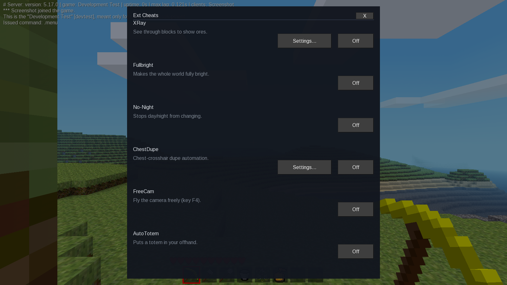

# Luanti but better by L4gLegend

A customized build of the Luanti 5.17.0 voxel game engine, with a native
client-side feature panel and additional client utilities.

## Screenshot

The in-game `.menu` panel provides access to the added client-side options:



## Features

- **Extension panel:** open it with `.menu` in chat to control the added
  client-side features.
- **Visual options:** X-Ray with an editable node list, Fullbright, and a
  daylight mode.
- **Freecam:** move the camera independently while your character stays at its
  original position.
- **Inventory helpers:** optional drop-all controls and a server-dependent
  ChestDupe client module.
- **UI utilities:** an additional panel with utilities for open formspecs.
- **Configurable keys:** the added Freecam, X-Ray, and UI-utilities shortcuts
  can be changed in Luanti's settings.

These are client-side modifications. Feature availability can vary between
servers, and some servers may prohibit their use; follow the rules of the
server you join.

## Downloads

Ready-to-run builds are available from the
[latest GitHub release](https://github.com/l4glegend/luanti-but-better/releases/latest):

- **Windows 64-bit:** [Luanti.but.better.by.L4gLegend.exe](https://github.com/l4glegend/luanti-but-better/releases/latest/download/Luanti.but.better.by.L4gLegend.exe) — a self-extracting launcher containing the modified engine.
- **Linux x86_64:** [Luanti.but.better.by.L4gLegend-x86_64.AppImage](https://github.com/l4glegend/luanti-but-better/releases/latest/download/Luanti.but.better.by.L4gLegend-x86_64.AppImage) — a portable application image.

The Windows launcher extracts the engine for the current Windows user. Neither
package includes games, worlds, or personal profile data. Install games
separately through Luanti's in-app content browser.

## Installation

### Windows 64-bit

1. Download `Luanti.but.better.by.L4gLegend.exe` from the latest release.
2. Double-click the downloaded `.exe`. It extracts the client for your Windows
   user and starts Luanti. On later launches, use the desktop or Start menu
   shortcut it creates.
3. In Luanti, open the **Content** tab and use **Browse online content** to
   find and install a game. Then select the installed game and create or join
   a world.

### Linux x86_64

1. Download `Luanti.but.better.by.L4gLegend-x86_64.AppImage` from the latest
   release.
2. Open a terminal in the download folder and make the file executable:

   ```bash
   chmod +x Luanti.but.better.by.L4gLegend-x86_64.AppImage
   ```

3. Start it from that folder:

   ```bash
   ./Luanti.but.better.by.L4gLegend-x86_64.AppImage
   ```

   Alternatively, use your file manager's **Allow executing file as program**
   option, then double-click the AppImage.
4. In Luanti, open the **Content** tab and use **Browse online content** to
   find and install a game. Then select the installed game and create or join
   a world.

The Windows launcher and Linux AppImage contain the engine, not a playable
game. Games are installed separately from inside Luanti; your worlds and
profile data are created locally when you use the client.

## Source and licensing

This repository contains the source used for these builds. The engine is based
on the [upstream Luanti project](https://github.com/luanti-org/luanti). See
[LICENSE.txt](LICENSE.txt), [COPYING.LESSER](COPYING.LESSER), and the notices
in individual source files for licensing and attribution.

For instructions on building the source, see the platform-specific guides in
[doc/compiling](doc/compiling/).
